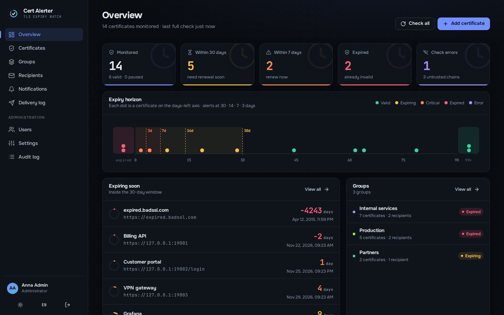
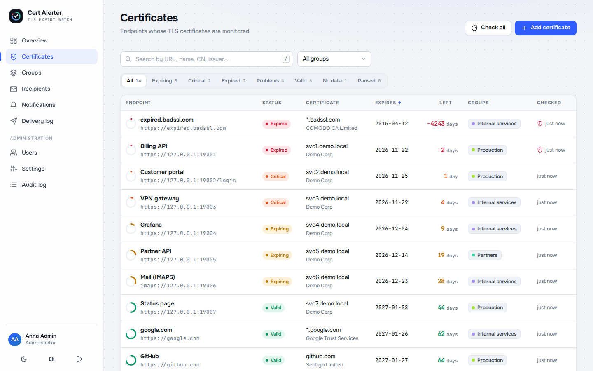
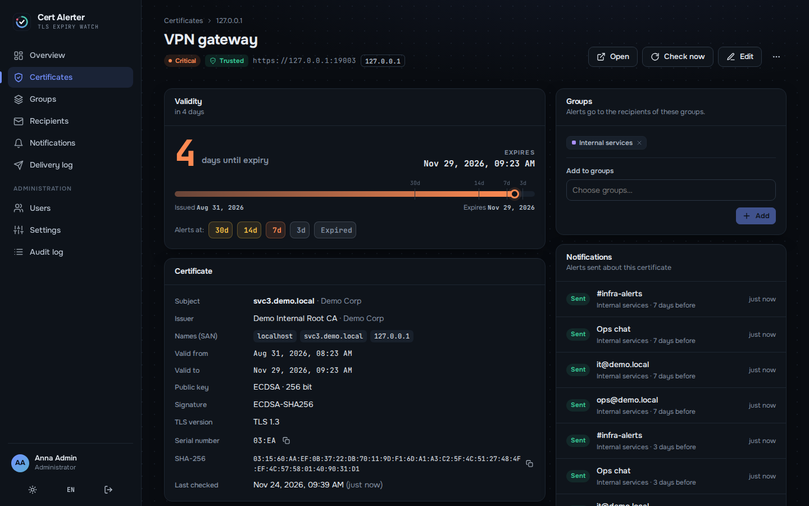
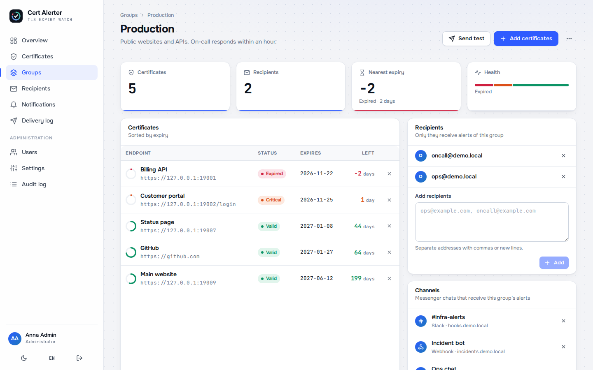
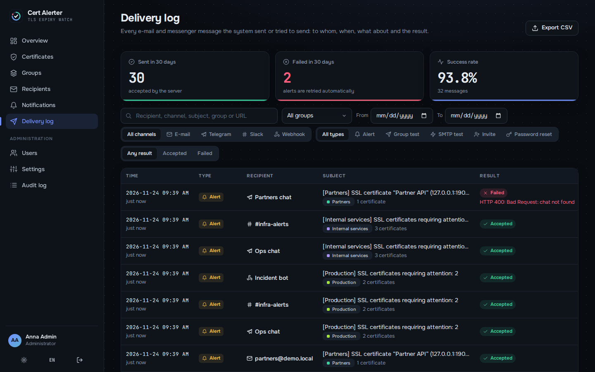
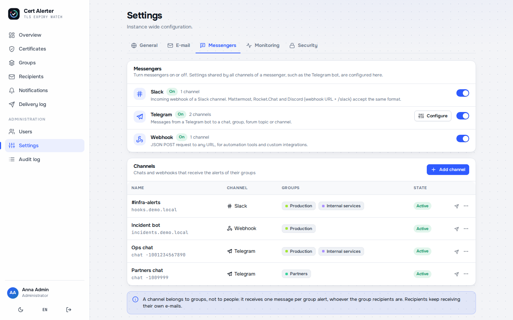

# Cert Alerter

[](https://github.com/master2sid2/cert-alerter/actions/workflows/ci.yml)
[](https://github.com/master2sid2/cert-alerter/releases)
[](go.mod)
[](LICENSE)

A web application that monitors SSL/TLS certificates by URL and sends alerts by e-mail and to
messengers (Telegram, Slack, webhooks) **strictly per group** **30, 14, 7 and 3 days** before
expiry (the thresholds are configurable).
It is a single static Go binary: the web UI is embedded (`embed`), the state is stored in
SQLite or, if needed, in MySQL/MariaDB.


*Recorded with made-up data: local test endpoints with a demo CA, a few public test hosts, a local mail catcher and a stand-in for the messenger APIs.*

<table>
  <tr>
    <td><a href="docs/screenshots/dashboard.png"></a></td>
    <td><a href="docs/screenshots/certificates.png"></a></td>
  </tr>
  <tr>
    <td><a href="docs/screenshots/certificate.png"></a></td>
    <td><a href="docs/screenshots/group.png"></a></td>
  </tr>
  <tr>
    <td><a href="docs/screenshots/delivery-log.png"></a></td>
    <td><a href="docs/screenshots/messengers.png"></a></td>
  </tr>
</table>

## Features

- **Certificate checks** by URL or `host:port` (`https://…`, `example.com:8443`,
  `ldaps://dc1:636`, `smtps://…`, IDN domains such as `bücher.example`, IPv6). The app reads the
  chain, validity period, SANs, issuer, key and TLS version, and verifies trust and the host name.
  Expired and self-signed certificates are shown too (marked "Untrusted").
- **Groups** contain certificates, recipients (e-mail addresses) and messenger channels. An alert
  about a certificate goes only to the recipients and channels of the groups it belongs to. An
  address that is in two groups gets two separate e-mails, each one only about the certificates of
  its own group.
- **Messengers**: Telegram (bot), Slack (incoming webhook; Mattermost, Rocket.Chat and Discord's
  Slack-compatible endpoint accept the same format) and a generic JSON webhook. A channel (a chat,
  a Slack channel, a webhook URL) is attached to groups and receives one message per group alert,
  independently of the group's e-mail recipients. Messengers are turned on and off in
  "Settings → Messengers"; tokens and webhook URLs are stored encrypted.
- **Alert stages** 30/14/7/3 days plus "expired" (enabled in the settings). Each stage is sent
  once per recipient; after a certificate is renewed the countdown starts over. When several
  certificates of one group trigger at once, a single digest e-mail is sent.
- **SMTP with TLS**: STARTTLS (587), implicit TLS/SMTPS (465) or no encryption (25);
  authentication auto/PLAIN/LOGIN/CRAM-MD5; verification of the SMTP server certificate (can be
  turned off); test e-mail straight from the settings page (even before saving). The SMTP password
  is stored encrypted (AES-256-GCM).
- **Delivery log**: every e-mail (alerts, tests, invitations, password resets) and messenger
  message with recipient or channel, time, subject, group and certificates, and the result
  ("accepted" or the error text, e.g. `535 Authentication credentials invalid` or
  `HTTP 400: Bad Request: chat not found`). Filters by channel, kind, result, group and dates,
  search, CSV export. Plus the history of alert stages for every certificate and group.
- **Dashboard**: summary, "expiry horizon" (all certificates on an axis of days left with threshold
  zones), upcoming expirations, problems (unreachable endpoints, untrusted chains), group health.
- **Multiple users**: e-mail invitations with a link to activate the account and choose a password,
  "admin" and "user" roles, self-service password reset, audit log.
- **Password policy in the UI**: length, character classes, password history, password lifetime
  (with a forced change), lockout after N failed sign-ins, session lifetime and idle timeout,
  link validity.
- English interface. The language switch (in the sidebar and on the sign-in page) lists every
  language registered in `web/static/js/lib/i18n.js`; to add one, put a dictionary
  `web/static/js/i18n/<code>.js` with the keys of `en.js` there and register it. E-mails are in
  English; their time zone is set in "Settings → General". Light and dark themes, responsive layout.

## Quick start

### Download

Binaries for Linux and macOS (amd64, arm64) are on the
[releases page](https://github.com/master2sid2/cert-alerter/releases), with `SHA256SUMS`:

```bash
chmod +x cert-alerter-v*-linux-amd64
./cert-alerter-v*-linux-amd64 serve      # http://localhost:8080, data in ./data
```

Or with Go 1.26+:

```bash
go install github.com/master2sid2/cert-alerter/cmd/cert-alerter@latest
```

### Build from source

```bash
make build                       # or: CGO_ENABLED=0 go build -o bin/cert-alerter ./cmd/cert-alerter
./bin/cert-alerter serve         # http://localhost:8080, data in ./data
```

Build for macOS on Apple Silicon (M1/M2/M3…), from any OS, no C compiler needed:

```bash
make build-darwin-arm64          # -> bin/cert-alerter-darwin-arm64
```

On the first start (while there are no users) a one-time link is printed to the log:

```
  First start: no users exist yet. Create the administrator account at
    http://localhost:8080/setup?token=…
```

Open it and create the administrator. The public address the page was opened from is stored as
the base URL for links in e-mails (it can be changed in "Settings → General").
For automated deployments the administrator can be created right away:
`CERT_ALERTER_ADMIN_EMAIL=… CERT_ALERTER_ADMIN_PASSWORD=…`.

### systemd service (Linux)

```bash
make build            # as a regular user
sudo make install     # binary, unit, /etc/default/cert-alerter, system user
sudo $EDITOR /etc/default/cert-alerter
sudo systemctl enable --now cert-alerter
sudo journalctl -u cert-alerter | grep setup      # first-run setup link
```

`make install` puts:

| File | Purpose |
|---|---|
| `/usr/local/bin/cert-alerter` | the binary |
| `/etc/systemd/system/cert-alerter.service` | the unit (`deploy/systemd/cert-alerter.service`) |
| `/etc/default/cert-alerter` | service options (`deploy/systemd/cert-alerter.default`), mode `0640`, group `cert-alerter` |

The service runs as the unprivileged system user `cert-alerter`, which `make install` creates when
it does not exist (`useradd --system`, no login shell, no home directory). To use another user,
create it yourself and pass `SERVICE_USER=name`. systemd creates `/var/lib/cert-alerter` (database,
secret key) and `/var/log/cert-alerter` (optional log files) owned by that user. The unit is
sandboxed: the file system is read-only except for these two directories, there are no
capabilities, and only the system calls of ordinary services are allowed.

`/etc/default/cert-alerter` has one active line with the command line flags, followed by every
flag as a commented example:

```bash
ARGS="-listen=:8080 -data-dir=/var/lib/cert-alerter"
```

systemd splits `ARGS` at whitespace and does not interpret quotes. Put values with spaces and
secrets (`CERT_ALERTER_SECRET_KEY`, a MySQL DSN with a password) into `CERT_ALERTER_*` variables in
the same file; they do not show up in `ps`. Apply changes with `systemctl restart cert-alerter`.

- An existing `/etc/default/cert-alerter` is never overwritten: the new example goes to
  `/etc/default/cert-alerter.new`.
- `PREFIX`, `BINDIR`, `SYSCONFDIR`, `UNITDIR` and `DESTDIR` work as usual. With `DESTDIR` (packaging)
  no user is created and systemd is not reloaded.
- `systemctl reload cert-alerter` reopens the log files.
- Ports below 1024 need `CAP_NET_BIND_SERVICE`; the lines to uncomment are in the unit.
- `sudo make uninstall` stops the service and removes the binary and the unit. It keeps the
  settings, the data and the user.

CLI commands on a server run as the service user:

```bash
sudo -u cert-alerter cert-alerter user list -data-dir=/var/lib/cert-alerter
sudo -u cert-alerter cert-alerter user set-password -email admin@example.com -data-dir=/var/lib/cert-alerter
```

With MySQL also pass `-db-driver=mysql -db-dsn=…`.

### Docker

```bash
docker compose up -d --build                                      # SQLite in a volume
docker compose -f deploy/docker-compose.mysql.yml up -d --build   # together with MySQL 8.4
docker compose logs cert-alerter | grep setup                     # first-run setup link
```

The image is ~30 MB (distroless, non-root, built-in `HEALTHCHECK`).

## How alerts work

1. All enabled endpoints are checked periodically (every 6 hours by default); new ones are
   checked right after they are added. If a check fails, the data of the last successful check is
   used, so expiry alerts keep working, and the error is shown on the dashboard.
2. Once a minute (and right after changes) the stage is computed for every
   *group × certificate × recipient* and *group × certificate × channel*: the smallest threshold that is not less than the number of
   full days left (5 days left → stage "7", 1 day → "3", expired → "expired").
3. Each stage is queued exactly once (the unique key includes the expiry date, so a renewed
   certificate starts the cycle again).
4. The queue is sent as digests, one e-mail per recipient and group and one message per channel
   and group. If several stages piled up while delivery was not working, only the most urgent one
   is sent. If the recipient, the channel or the certificate is no longer in the group, or the
   channel or its messenger was turned off, the notification is cancelled.
5. Failed sends are retried with growing delays (5 min → 15 min → 1 h → 3 h → 6 h, up to
   12 attempts). If SMTP is not configured yet, e-mail alerts accumulate and are sent once it is.

### Messenger channels

| Messenger | Messenger settings | Channel settings |
|---|---|---|
| Telegram | bot token from @BotFather, optional Bot API URL | chat id (`-100…` for groups and channels, or `@channel`), optional topic id, silent mode |
| Slack | none | incoming webhook URL (Mattermost, Rocket.Chat, Discord `…/slack` work too) |
| Webhook | none | URL, optional `Authorization` header |

The webhook receives a `POST` with a JSON body:

```json
{
  "event": "alert",
  "app": "Cert Alerter",
  "app_url": "https://certs.example.com/",
  "group": {"name": "Production", "url": "https://certs.example.com/groups/1"},
  "severity": "critical",
  "title": "[Production] SSL certificate api.example.com expires in 5 days",
  "text": "plain text version of the whole message",
  "certificates": [
    {"name": "API", "endpoint": "https://api.example.com", "subject_cn": "api.example.com",
     "issuer_cn": "R11", "not_after": "2026-03-06T09:00:00Z", "days_left": 5,
     "severity": "critical", "url": "https://certs.example.com/certificates/7"}
  ]
}
```

`event` is `test` for test messages. Requests to messengers use the trust store of the checks
(`-ca-file`) and the `HTTPS_PROXY`/`NO_PROXY` environment variables; "Skip TLS verification" is
available per Slack and webhook channel. Every channel can be tested from its form before saving.

A new messenger is one file in `internal/notify` implementing `notify.Provider` (field
descriptions plus `Send`) and registering itself in `init`; the web interface builds its forms from
the field descriptions.

No new alerts are created for a certificate that expired more than 90 days ago.

## Roles

| Action                                               | Admin | User |
|------------------------------------------------------|:-----:|:----:|
| View the dashboard, certificates, groups, recipients, notifications, delivery log | ✓ | ✓ |
| Add certificates (one by one or as a list), run checks | ✓ | ✓ |
| Put certificates into groups                         | ✓ | ✓ |
| Edit/delete certificates, remove them from groups    | ✓ | — |
| Create, edit and delete groups                       | ✓ | — |
| Manage recipients (e-mail lists)                     | ✓ | — |
| Messengers and channels, attach channels to groups   | ✓ | — |
| Users, invitations, settings, audit log              | ✓ | — |

Permissions are enforced by the server (the API returns 403); the UI merely hides unavailable
actions. Invitation and password reset e-mails in the delivery log are visible to admins only.
Users cannot change their own role or status, and the last active admin cannot be removed.

## Configuration

Process options are set with flags or environment variables; everything else is configured in the
UI (mail, thresholds, check interval, security policy, e-mail time zone).

| Variable | Flag | Default | Purpose |
|---|---|---|---|
| `CERT_ALERTER_LISTEN` | `-listen` | `:8080` | HTTP listen address |
| `CERT_ALERTER_DB_DRIVER` | `-db-driver` | `sqlite` | `sqlite` or `mysql` |
| `CERT_ALERTER_DB_DSN` | `-db-dsn` | `<data-dir>/cert-alerter.db` | SQLite path or MySQL DSN `user:pass@tcp(host:3306)/db` |
| `CERT_ALERTER_DATA_DIR` | `-data-dir` | `data` | directory for SQLite and the generated key |
| `CERT_ALERTER_SECRET_KEY` | `-secret-key` | — | passphrase that encrypts the SMTP password; without it a key is created in `<data-dir>/secret.key` |
| `CERT_ALERTER_BASE_URL` | `-base-url` | — | public URL for links in e-mails (overrides the value from the settings) |
| `CERT_ALERTER_TLS_CERT`, `CERT_ALERTER_TLS_KEY` | `-tls-cert`, `-tls-key` | — | serve HTTPS directly |
| `CERT_ALERTER_TRUST_PROXY` | `-trust-proxy` | `false` | trust `X-Forwarded-For/Proto` from a reverse proxy |
| `CERT_ALERTER_COOKIE_SECURE` | `-cookie-secure` | `auto` | cookie Secure flag: `auto`, `always`, `never` |
| `CERT_ALERTER_CA_FILE` | `-ca-file` | — | PEM with additional trusted CAs (internal corporate CA) |
| `CERT_ALERTER_SCHEDULER` | `-scheduler` | `true` | run scheduled checks and alerts on this instance |
| `CERT_ALERTER_ADMIN_EMAIL`, `CERT_ALERTER_ADMIN_PASSWORD` | `-admin-email`, `-admin-password` | — | create an admin when the database is empty |
| `CERT_ALERTER_LOG_LEVEL` | `-log-level` | `info` | application log level: `debug`, `info`, `warn`, `error` |
| `CERT_ALERTER_LOG_FORMAT` | `-log-format` | `text` | application log format: `text` or `json` |
| `CERT_ALERTER_LOG_FILE` | `-log-file` | `stderr` | application log destination: `stderr`, `stdout`, `off` or a file path |
| `CERT_ALERTER_ACCESS_LOG` | `-access-log` | `stdout` | HTTP access log destination: `stdout`, `stderr`, `off` or a file path |
| `CERT_ALERTER_ACCESS_LOG_FORMAT` | `-access-log-format` | `text` | access log format: `text` or `json` |
| `CERT_ALERTER_STATIC_DIR` | `-static-dir` | — | development: serve the UI from disk instead of the embedded copy |

Behind a reverse proxy (nginx etc.) set `CERT_ALERTER_TRUST_PROXY=true` and
`CERT_ALERTER_BASE_URL=https://certs.example.com`.

## Logs

The application writes two independent logs:

- **application log**: startup, certificate checks, sent e-mails, errors. slog format `text` or
  `json`, written to stderr by default;
- **access log**: one line per HTTP request, written to stdout by default. Fields: client IP
  (taken from `X-Forwarded-For` with `CERT_ALERTER_TRUST_PROXY`), date and time, method, URL and
  protocol version, status code, response size in bytes, Referer and User-Agent.

```text
10.0.0.7 [21/Nov/2026:10:15:02 +0000] "GET /api/certificates HTTP/1.1" 200 5120 "-" "Mozilla/5.0 …"
```

The `json` format has the same fields: `time`, `remote_ip`, `method`, `uri`, `proto`, `status`,
`bytes`, `referer`, `user_agent`.

Each log can go to its own file, be switched off (`off`) or share a file with the other one:

```bash
cert-alerter serve -log-file /var/log/cert-alerter/app.log \
  -access-log /var/log/cert-alerter/access.log -access-log-format json
```

Invitation, password reset and first-run setup tokens never reach the logs: in the paths
`/invite/…`, `/reset/…`, `/api/auth/token/…` and in the `token` parameter they are replaced with
`REDACTED`.

Files are opened for appending with mode `0640`; missing directories are created. On `SIGHUP` the
application reopens its log files, so logrotate works without a restart:

```text
/var/log/cert-alerter/*.log {
    daily
    rotate 14
    compress
    delaycompress
    missingok
    notifempty
    postrotate
        systemctl reload cert-alerter.service
    endscript
}
```

## SQLite → MySQL

The schema is maintained for both databases (migrations run automatically on start, times are
stored as Unix time, the SQL is portable). To switch:

```bash
# 1. stop the application (or copy the database file)
# 2. copy the data; the MySQL schema is created automatically, ids are preserved
cert-alerter db-copy -from-dsn data/cert-alerter.db \
  -to-driver mysql -to-dsn 'alerter:secret@tcp(db.example.com:3306)/cert_alerter'
# 3. start with MySQL, keeping the same encryption key (CERT_ALERTER_SECRET_KEY or data/secret.key)
CERT_ALERTER_DB_DRIVER=mysql CERT_ALERTER_DB_DSN='alerter:secret@tcp(db.example.com:3306)/cert_alerter' cert-alerter serve
```

The reverse direction (`-from-driver mysql -to-driver sqlite`) works too. Supported are
MySQL 8.0+ and MariaDB 10.5+ (utf8mb4 character set).

**Several instances** sharing one MySQL database are safe: scheduled jobs run only on the instance
that holds the lease in the `app_locks` table (taken over after 90 s if that instance disappears).
Manual checks from the UI work on any instance.

## Security

- Passwords: Argon2id (OWASP parameters), password history, policy enforced by the server.
- Server-side sessions (the cookie holds only a random token, the database its SHA-256),
  `HttpOnly`, `SameSite=Lax`, `Secure` over HTTPS; absolute lifetime and idle timeout.
- CSRF protection (`http.CrossOriginProtection`), strict CSP without inline scripts,
  `X-Frame-Options: DENY`, `Referrer-Policy: no-referrer`, HSTS over HTTPS.
- Account lockout after N failed sign-ins, rate limiting of sign-in and password reset requests,
  identical responses and response times for existing and unknown addresses.
- Invitation and reset links are single-use and expire; only their hash is stored.
- The SMTP password, messenger tokens and webhook URLs are encrypted with AES-256-GCM and never
  sent back to the browser; delivery errors never contain them. The audit log records sign-ins, failed
  attempts, and changes of data and settings.

## Command line

```
cert-alerter serve                 web server and scheduler (default)
cert-alerter migrate               apply migrations and exit
cert-alerter user create -email a@b.c -role admin [-password-stdin]
cert-alerter user set-password -email a@b.c       recover access (also unlocks and activates)
cert-alerter user list
cert-alerter db-copy …             copy data between databases
cert-alerter healthcheck           liveness check (used by Docker)
cert-alerter version
```

Without `-password`/`-password-stdin` the `user` commands generate a password and print it.

## HTTP API

The UI is built on a JSON API (`/api/…`) that can also be used for automation with a cookie
session: `POST /api/auth/login`, `GET/POST /api/certificates`, `POST /api/certificates/bulk`,
`POST /api/certificates/{id}/check`, `GET /api/groups/{id}`, `POST /api/groups/{id}/certificates`,
`GET /api/mail-log` (`?channel=&kind=&status=&group_id=&from=&to=&q=`), `GET/POST /api/channels`, `GET /api/mail-log/export` (CSV),
`GET /api/dashboard`, `GET /healthz` and more. The full list of routes is in
`internal/server/server.go`.

## Development

```bash
make dev          # the UI is served from web/static: frontend edits need no rebuild
make test         # tests on SQLite
make mysql-up && make test-mysql   # the same tests on MySQL 8.4 as well (Docker)
```

Layout:

```
cmd/cert-alerter     entry point and CLI
internal/checker     TLS connection, URL parsing, chain verification
internal/monitor     scheduled and manual checks, scheduler lease
internal/alerts      stages, alert queue, digests, retries
internal/mailer      SMTP (go-mail), e-mail templates, delivery log of e-mails
internal/notify      messenger providers (Telegram, Slack, webhook), channels, delivery
internal/logging     application and access logs, log files
internal/store       data access (SQLite/MySQL); internal/db holds migrations and dialects
internal/server      HTTP API, sessions, permissions, embedded UI
web/static           Preact + htm SPA without a build step (embedded into the binary)
```

The frontend needs no Node.js: ES modules are loaded directly, Preact + htm live in
`web/static/vendor` as one file. The Onest and JetBrains Mono fonts (OFL) are embedded.

## License

[MIT](LICENSE). Bundled third-party files: Preact (MIT) and htm (Apache-2.0) in
`web/static/vendor`, the Onest and JetBrains Mono fonts (SIL OFL 1.1) in `web/static/fonts`;
their licenses are next to them.
